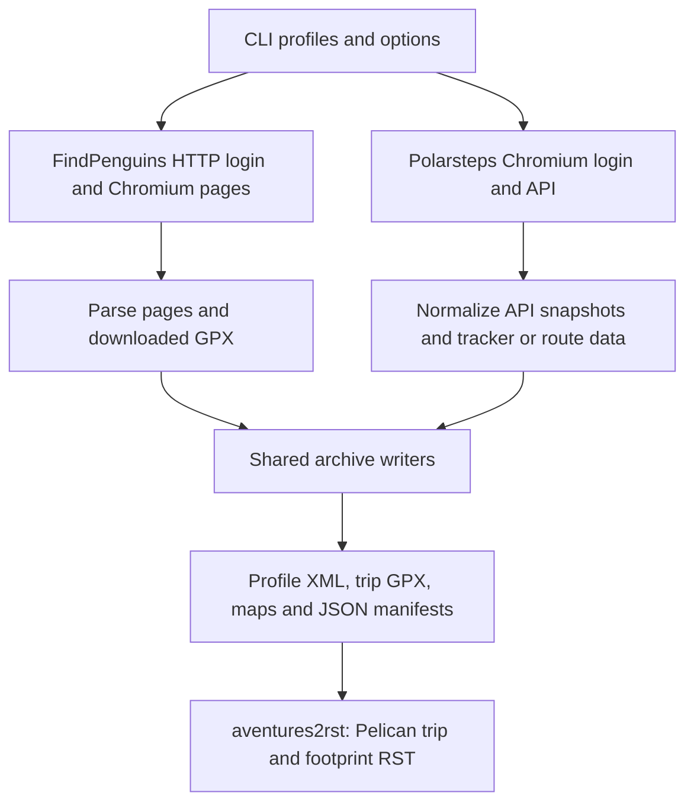

# scrapers Architecture

This document describes the current data flow and generated outputs.

## Goals

- Authenticate and load FindPenguins pages or Polarsteps API data.
- Save profile/trip data and downloaded media locally.
- Generate a profile XML index and an enriched GPX file per trip.
- Generate Pelican RST articles for trips and footprints.

## Main Components

- `scrapers.py`: CLI argument parsing and program dispatch.
- `findpenguins.py` / `polarsteps.py`: service-specific archive orchestration.
- `polarsteps_config.py`: Polarsteps endpoints, API version and weather mappings.
- `polarsteps_utils.py`: Polarsteps login, API access, snapshots and media downloads.
- `polarsteps_parsers.py`: normalize Polarsteps API data into the shared archive schema.
- `common_profiles.py`: shared profile-file parsing and default settings.
- `output_safety.py`: shared `--force` cleanup and path safety checks.
- `common_archive.py`: write portable per-profile and per-trip JSON manifests.
- `aventures_archive.py`: read manifests and resolve archive-relative media paths.
- `aventures2rst.py`: independent archive-to-Pelican conversion.
- `reminder.py` / `reminders2rst.py`: `rem export` JSON export and per-reminder Pelican articles.
- `findpenguins_config.py`: FindPenguins endpoints and request headers; `common_config.py`: XML namespaces.
- `findpenguins_utils.py`: login, Playwright setup, page loading and downloads.
- `findpenguins_parsers.py`: profile, trip, insight and footprint extraction.
- `common_writers.py`: shared XML/GPX serialization and route-map WebP images.
- `common_elevation.py`: OpenTopoData SRTM90m enrichment for GPX track-point elevations.
- `aventures_writers.py`: Pelican RST articles and country maps.
- `common_utils.py`: shared XML, text and image helpers.

## Runtime Data Flow

Each scraper normalizes source data into dictionaries for the shared writers. FindPenguins
normally logs a trip-level error and continues; Polarsteps propagates errors. Both can replay
saved source data with `--skip`. Both scrapers may query an elevation service during replay.

## Output Layout

For profile id `<uid>`, the primary archive is written under `--output`:

- `<output>/<uid>/<uid>.xml`: profile and trip index.
- `<output>/<uid>/profile.json` and `<output>/<uid>/<trip-slug>/trip.json`: manifests used by the independent converter.
- `<output>/<uid>/<trip-slug>.gpx`: route and footprint waypoints.
- `<output>/profiles.xml`: merged index when more than one profile is processed.
- `<output>/<uid>/<trip-slug>/`: trip image, footprint photos/videos and `map_trip.webp`
  when a valid route is available. FindPenguins also attempts `satellite_trip.webp`.

FindPenguins saves the profile page as `<output>/<uid>/page-<sha256>.html`, and trip and
footprint pages in the trip directory using the same naming scheme. Each footprint's popup data
is saved there as `page-<sha256>.popup.json`, with the same URL hash as its HTML; trip insights
are saved as `insights.html` when obtained. The downloaded trip GPX is temporarily written in
the trip directory and normally removed after the enriched GPX is produced.

Polarsteps instead saves the profile response as `<output>/<uid>/api-user.json` and each trip
response as `<output>/<uid>/<trip-slug>/api-trip.json`. Its trip slugs start with the numeric ID,
and step media uses `step-<step-id>-<media-id>` filenames. It does not create HTML snapshots.
These source files are distinct from the normalized manifests and may contain private data.
See the [README](../README.md) output examples for the full layouts.

The converter writes Pelican articles under `--content` (default
`../website/content/articles/findpenguins`): `<content>/<uid>/<trip-slug>/trip.rst` and one
`footprint_N/footprint.rst` per footprint. Media and maps are copied beside the sources. The
`--category` option (default `findpenguins`) sets the trip category and the first service tag on
trip and footprint articles. The trip article uses the `findpenguins_trip` template and includes
`Date` (first footprint), `EndDate` (last footprint plus its nights) and `Transport` metadata;
generated articles use the owner's name as `Author`.

All downloaded and generated images are stored as lossless WebP; videos are untouched.

Route maps are 1200×800 WebP images with a white route line. The default background is transparent;
`satellite` and `street` backgrounds use Esri's export service for FindPenguins. Footprint
bubbles are opt-in for the FindPenguins main map; Polarsteps uses a transparent map without them.
Trips without a valid GPX track do not get a route map.

## Design Decisions

- Keep parser logic separate from serialization.
- Keep media paths in the JSON manifests relative to the archive root so archives can be moved.
- Use the downloaded FindPenguins GPX or Polarsteps tracker/route data as the track source;
  regenerate waypoints from footprints and preserve the track elements.
- Add each coordinate-bearing footprint as a waypoint, with available fields in
  GPX extensions.
- Keep the profile XML index lightweight: trips refer to their GPX file and include companion
  metadata.
- Omit unavailable optional fields; report failures according to the source scraper.

## Extensibility

- Add extraction logic in `findpenguins_parsers.py` or `polarsteps.py`.
- Map new fields to XML/GPX in `common_writers.py` or RST in `aventures_writers.py`.
- Add CLI behavior in `scrapers.py` and service orchestration in the appropriate scraper.
- Keep [`api-reference.md`](./api-reference.md) and source docstrings in sync when changing functions.
- Update [`data-fields.md`](./data-fields.md) and [`xml-gpx-structure.md`](./xml-gpx-structure.md)
  when changing exported fields or schemas.
